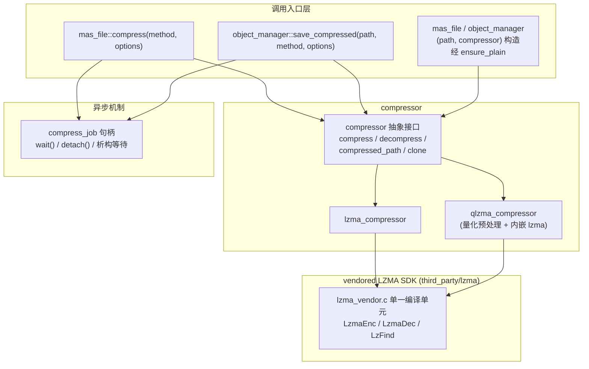

[English](serialization_and_compression_en.md) | 中文

## 序列化、mas文件格式 与 object_manager

### 概述

序列化能力由泛型 `serialization::save/load` 与命名块存储 `mas_file` 正交组合而成；`object_manager` 则是建立在这两层之上、便于多类型多对象序列化的容器。

### 序列化树：save/load 的递归分解

`save(fp, name, obj)` / `load(fp, name, obj)` 按类型重载逐层下钻：复合类型（`map`、`vector`、`tagged_struct`、`simple_grid`、`host_field`、`device_field`、`particle_group` 等）把子成员以 `name` + 相对名继续调用 `save`；标量（`foundation.hpp:20-33`）、`std::string`、`vector<基础类型>`、定长 `Eigen::Matrix` 这类可整体写入单块的类型是叶子。任何值的 save 过程自然展开为一棵树：**树 = 类型结构的递归分解，块名路径 = 根值到叶子的树路径**。典型的子块命名规则如下：

| 类型 | 子块命名 |
|------|---------|
| `map` / `unordered_map` | `name.keys` + `name.values`；键作为数据存入 `.keys`，不进入块名 |
| `vector<基础类型>`（含 `vector<bool>`） | 单个叶子块，shape `{N,1}` |
| `vector<定长 Eigen::Matrix>` | 单个块，shape `{N,Rows,Cols}`；维数动态时退化为逐元素 |
| `vector<其它元素>` | `name.size`（uint64 标量）+ 逐元素 `name[i]` |
| `tagged_struct` | 逐标签 `name.标签名` |
| `Container<tagged_struct>`（如 `vector<Particle>`） | SoA：每个标签一个块 `name.标签名`；设备容器不适用 |
| `device_vector` | `name.device`（设备名）+ `name.content` |
| 其它类型（泛型兜底） | 单个块：`fp.writeData(name, obj)` |

例如：

```cpp
using Particle = tagged_struct<
    tag_bind<property::position, Eigen::RowVector2d>,
    tag_bind<property::velocity, Eigen::RowVector2d>,
    tag_bind<property::charge, double>,
    tag_bind<property::mass, double>>;

std::map<std::string, std::vector<Particle>> species;
species["electron"] = {/* 3 个粒子 */};
species["ion"]      = {/* 2 个粒子 */};

mas_file fp("state.mas", mas_file::replaceMode);
save(fp, "particles", species);
```

`map` 先拆为 `.keys` / `.values`：键是 `std::string`，逐元素存为 char 块；`.values` 的每个元素是 `vector<Particle>`，命中 SoA 重载，每个标签整体一块。展开后的块名树：

```text
particles                                    map<string, vector<Particle>>
├── particles.keys.size                      uint64   1×1
├── particles.keys[0]                        char     8×1     "electron"
├── particles.keys[1]                        char     3×1     "ion"
├── particles.values.size                    uint64   1×1
├── particles.values[0]                      vector<Particle>（SoA）
│   ├── particles.values[0].position         double   3×1×2
│   ├── particles.values[0].velocity         double   3×1×2
│   ├── particles.values[0].charge           double   3×1
│   └── particles.values[0].mass             double   3×1
└── particles.values[1]                      vector<Particle>（SoA）
    ├── particles.values[1].position         double   2×1×2
    ├── particles.values[1].velocity         double   2×1×2
    ├── particles.values[1].charge           double   2×1
    └── particles.values[1].mass             double   2×1
```

### mas_file：命名块的顺序存储

`mas_file` 把文件视为命名块的顺序追加流。每个块自描述，依次为：魔串 `#MAS!#`（识别串）；块名长度、类型名长度、shape 维数；块名、类型名、逐维 `size_t` 的 shape；块实际内容。由于块的头部区声明了内容的大小，扫描整个mas文件中所有块的情况通常是比较快的。

- `writeData` 以追加模式打开文件，块序即写入序；默认禁止同名同类块重复写入。
- 打开模式：`autoMode` 获取全文件的块信息，或在不存在时新建；`replaceMode` 清空重建；`quickMode` 不读块头（不建议）。
- `readData(name)` 按块头定位并整块读出。
- `smashData` 把块名首字符改写为 `'!'` 使块失效；`replaceData` = 失效旧块 + 追加新块，旧载荷不做物理删除。
- 因此，mas文件在常规使用时是 *只增不减* 的。

### object_manager：多带名根的便捷容器

使用 `object_manager` 可以托管许多类型的构造过程，托管的对象可以自动形成聚合的 `save` 和 `load`。

`obj<T>(name)` 惰性获取，首次访问时依次执行：

1. 构造对象：可默认构造则默认构造，否则经 manager 持有的 queue 构造；如二者都不可，该类型不可为object_manager托管。
2. 以 `类型名[对象名]`为块名，从绑定文件尝试加载（`object_manager.hpp:232-243`）；
3. 加载失败则保留新构造的对象，随后注册 saver。

`save` 的语义（`object_manager.hpp:129-161`）：

- 路径非空、父目录存在，且不得与绑定的源文件为同一文件
- 依序执行全部 saver；源文件中无 saver 对应的块被原样搬运进目标文件，即未被管理的数据也随保存续存；

object_manager 设计使其非常适合进行断点管理。

```cpp
object_manager mng1("");
auto& va1 = mng1.obj<T>("a");
auto& vb1 = mng1.obj<T>("b");
... // 使用va1
... // 使用vb1
mng1.save("checkpoint1.mas");
...
object_manager mng2("checkpoint1.mas");
auto& va2 = mng2.obj<T>("a"); // 获得mng1调用save时的va1状态
... // 使用va2
mng2.save("checkpoint2.mas");
...
object_manager mng3("checkpoint2.mas");
auto& va3 = mng3.obj<T>("a"); // 获得mng2调用save时的va2状态
auto& vb3 = mng3.obj<T>("b"); // 尽管mng2没有托管b，但能够读出mng1调用save时的vb1状态
```

## 序列化文件的压缩功能

### 概述

MAS 文件是顺序追加的二进制格式，不做任何压缩；大规模粒子/场量状态的磁盘占用相当可观。
序列化模块因此引入了文件级压缩能力，由三部分组成：

- **`compressor` 抽象接口**：运行时多态的压缩器约定（`src/serialization/compressor.hpp`）。
- **`lzma_compressor`**：无损 LZMA 压缩实现，基于 vendored 的 LZMA SDK（`third_party/lzma`，公有领域）。
- **`qlzma_compressor`**：带 double 尾数量化预处理的 LZMA 压缩器（有损）。

PSuM中的压缩功能是通过外部的通用压缩算法库实现的，具有通用性，以**整个文件**为单位，与 MAS 内部的数据块结构无关。
压缩任务统一通过 `compress_job` 句柄表达。

#### 压缩器类型

| 压缩器 | 压缩文件后缀 | 是否有损 | 说明 |
|--------|-------------|---------|------|
| `lzma_compressor` | `.lzma` | 无损 | 压缩-解压 roundtrip 字节一致 |
| `qlzma_compressor` | `.lzma` | 对 MAS 中的大 double 块有损 | 量化预处理 + LZMA；非 MAS 文件退化为无损 LZMA |

#### 整体架构图




#### 保存-压缩-恢复流程

```text
保存侧（object_manager::save_compressed）:
1. object_manager::save(path)                  同步写出明文 MAS
2. 后台线程: worker->compress(path, options)    生成 path.lzma（临时名 + rename 原子发布）
3. 后台线程: 删除明文 path                      （严格在压缩成功之后）

恢复侧（带压缩器的构造函数）:
1. ensure_plain(path, method) 即 method.decompress(path)    由压缩后文件 path.lzma 重建明文文件 path
2. 之后按普通 MAS 文件打开
```

### 接口规范

#### compressor 抽象接口

定义于 `src/serialization/compressor.hpp`：

```cpp
struct compressor {
    virtual ~compressor() = default;
    // 明文文件 -> 压缩文件
    virtual void compress(const std::filesystem::path& file_path, const std::string& options = "") const = 0;
    // 压缩文件 -> 明文文件
    virtual void decompress(const std::filesystem::path& file_path) const = 0;
    // 明文文件对应的压缩文件路径（如 "a.mas" -> "a.mas.lzma"）
    virtual std::filesystem::path compressed_path(const std::filesystem::path& file_path) const = 0;
    // 生成另一个同类型实例（供compress_job实现类型擦除）
    virtual std::shared_ptr<const compressor> clone() const = 0;
};
```

约定：

- `compress` 的输入是明文文件路径，输出路径由 `compressed_path` 决定; 压缩失败不能破坏明文文件
- `decompress` 的输入也是明文路径，内部定位其压缩文件并重建明文文件；解压失败不能破坏压缩文件，**明文文件如存在会被覆盖重写**。

#### compress_job 句柄

`mas_file::compress` 与 `object_manager::save_compressed` 都返回 `compress_job`：
该对象是压缩线程的句柄，在压缩完成后析构。

| 用法 | 行为 |
|------|------|
| 不调用任何方法 | 析构时等待完成 |
| `job.wait()` | 等待完成；若工作线程捕获了异常，在此抛出 |
| `job.detach()` | 线程脱离，错误不再向调用方报告，也不再阻塞 |

### 选项与语义

可以通过传入字符串对所用的压缩算法进行更细粒度的设置（如，用更长的压缩时间换取可能更好的压缩效果）。

#### lzma_compressor 选项

直接使用lzma算法。
选项字符串由逗号或分号分隔的 `key=value` 项组成，只接受两个键：

| 键 | 取值 | 默认 | 说明 |
|----|------|------|------|
| `level` | 0..9 | 4 | LZMA 压缩级别 |
| `dict` | 无后缀数字，或带 `k`/`m`/`g` 后缀 | 0（用内置 4 MiB） | 字典大小，必须 < 4 GiB |

示例：`"level=9"`、`"dict=64m,level=6"`。

解析失败情形：缺少 `=`、非法数字、非法后缀、未知键、越界取值等；抛出 `std::runtime_error`。

#### qlzma_compressor 选项

`qlzma_compressor` 在 LZMA 之前对文件内容做一遍量化预处理：

1. 检查文件头是否为 MAS 魔串 `#MAS!#`；不是则直接退化为普通 LZMA 压缩（其余选项语义不变）。
2. 按 MAS 结构解析文件；只对 **double 类型且元素数 ≥ 1024** 的数据块做尾数舍入量化，
   其余数据块（标量、元数据、整数索引、小数组）原样按原顺序拷贝。
3. 量化副本交给 LZMA 压缩并以最终名发布，中间文件被清理。

量化档位由选项 `q` 指定。`q` 属于量化阶段，其余选项项原样转发给 LZMA 阶段：

| 档位 | 保留尾数位数 | 相对误差量级 |
|------|------------|-------------|
| `q=40` | 40 | ~1e-12 |
| `q=32` | 32 | ~1e-10 |
| `q=24` | 24 | ~1e-8 |
| `q=20`（默认） | 20 | ~1e-7 |
| `q=16` | 16 | ~1e-5 |

注意事项：

- 量化是**不可逆**的：解压只能得到量化后的数值。`qlzma_compressor` 适合可容忍精度损失的场景，不适合存档需要精确复原的数据。
- `q` 取其他值（如 `q=31`）在解析时抛出 `std::runtime_error`。
- 魔串匹配但块结构解析失败的文件按非 MAS 文件对待，退化为无损 LZMA。

对于存在大量块状 double 数据的mas文件，量化通常可以显著改善压缩效果。