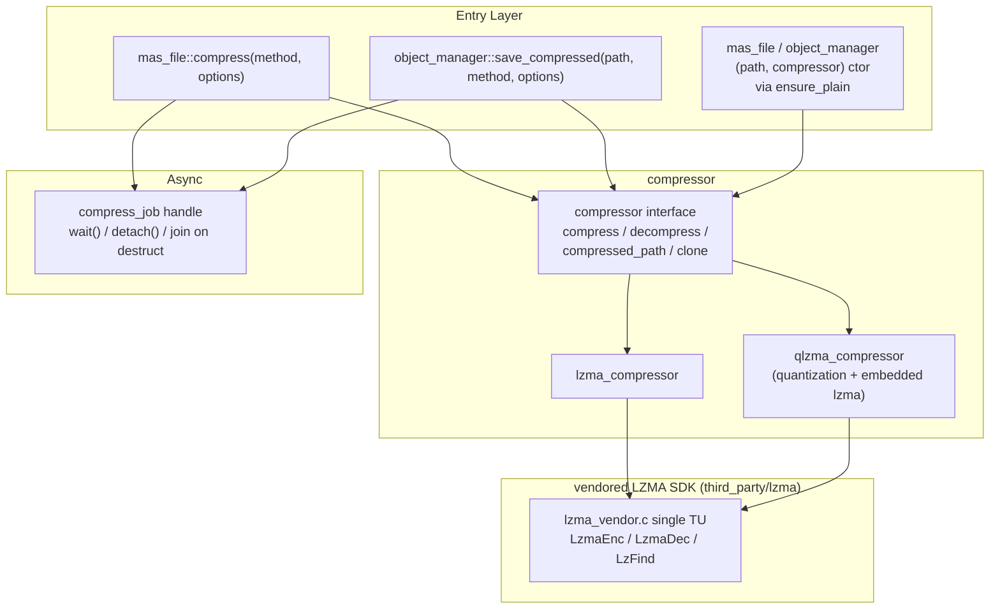

English | [中文](serialization_and_compression.md)

## Serialization, the MAS File Format and object_manager

### Overview

The serialization capability is composed orthogonally of the generic `serialization::save/load` and the named-block store `mas_file`; `object_manager` is a container built on top of these two layers that makes it convenient to serialize many types and many objects.

### The Serialization Tree: Recursive Decomposition of save/load

`save(fp, name, obj)` / `load(fp, name, obj)` drill down layer by layer through per-type overloads: composite types (`map`, `vector`, `tagged_struct`, `simple_grid`, `host_field`, `device_field`, `particle_group`, ...) call `save` again for each sub-member with `name` + a relative name; types that can be written as a whole into a single block are leaves, such as scalars (`foundation.hpp:20-33`), `std::string`, `vector<fundamental>` and fixed-size `Eigen::Matrix`. The save process of any value thus unfolds naturally into a tree: **the tree = the recursive decomposition of the type structure, and the block-name path = the tree path from the root value to a leaf**. The typical sub-block naming rules are:

| Type | Sub-block naming |
|------|---------|
| `map` / `unordered_map` | `name.keys` + `name.values`; keys are stored as data inside `.keys`, never in block names |
| `vector<fundamental>` (incl. `vector<bool>`) | a single leaf block, shape `{N,1}` |
| `vector<fixed-size Eigen::Matrix>` | a single block, shape `{N,Rows,Cols}`; degrades to element-wise when dimensions are dynamic |
| `vector<other elements>` | `name.size` (uint64 scalar) + element-wise `name[i]` |
| `tagged_struct` | per tag `name.tag_name` |
| `Container<tagged_struct>` (e.g. `vector<Particle>`) | SoA: one block per tag `name.tag_name`; not applicable to device containers |
| `device_vector` | `name.device` (device name) + `name.content` |
| other types (generic fallback) | a single block: `fp.writeData(name, obj)` |

For example:

```cpp
using Particle = tagged_struct<
    tag_bind<property::position, Eigen::RowVector2d>,
    tag_bind<property::velocity, Eigen::RowVector2d>,
    tag_bind<property::charge, double>,
    tag_bind<property::mass, double>>;

std::map<std::string, std::vector<Particle>> species;
species["electron"] = {/* 3 particles */};
species["ion"]      = {/* 2 particles */};

mas_file fp("state.mas", mas_file::replaceMode);
save(fp, "particles", species);
```

The `map` is first split into `.keys` / `.values`: the keys are `std::string`, stored element-wise as char blocks; each element of `.values` is a `vector<Particle>`, which hits the SoA overload, one whole block per tag. The resulting block-name tree:

```text
particles                                    map<string, vector<Particle>>
├── particles.keys.size                      uint64   1×1
├── particles.keys[0]                        char     8×1     "electron"
├── particles.keys[1]                        char     3×1     "ion"
├── particles.values.size                    uint64   1×1
├── particles.values[0]                      vector<Particle> (SoA)
│   ├── particles.values[0].position         double   3×1×2
│   ├── particles.values[0].velocity         double   3×1×2
│   ├── particles.values[0].charge           double   3×1
│   └── particles.values[0].mass             double   3×1
└── particles.values[1]                      vector<Particle> (SoA)
    ├── particles.values[1].position         double   2×1×2
    ├── particles.values[1].velocity         double   2×1×2
    ├── particles.values[1].charge           double   2×1
    └── particles.values[1].mass             double   2×1
```

### mas_file: Sequential Storage of Named Blocks

`mas_file` treats the file as a sequentially appended stream of named blocks. Each block is self-describing, consisting in order of: the magic string `#MAS!#` (identification); the block-name length, type-name length and shape dimensionality; the block name, the type name, and one `size_t` per shape dimension; the actual block content. Since a block's header region declares the size of its content, scanning all blocks of a mas file is usually fairly fast.

- `writeData` opens the file in append mode; the block order is the write order; duplicate writes of same-name, same-type blocks are forbidden by default.
- Open modes: `autoMode` collects the block information of the whole file, or creates the file if absent; `replaceMode` clears and rebuilds; `quickMode` skips reading block headers (not recommended).
- `readData(name)` locates the block via its header and reads it out as a whole.
- `smashData` invalidates a block by rewriting the first character of its name to `'!'`; `replaceData` = smash the old block + append the new one; old payloads are not physically removed.
- Consequently, a mas file is *append-only* in regular use.

### object_manager: A Convenient Container for Many Named Roots

With `object_manager` the construction process of many types can be entrusted to the manager, and the managed objects automatically form an aggregated `save` and `load`.

`obj<T>(name)` performs a lazy acquisition; on first access it does, in order:

1. Construct the object: default-constructed if possible, otherwise constructed through the queue held by the manager; if neither is possible, the type cannot be managed by object_manager.
2. Try to load it from the bound file with `type_name[object_name]` as the block name (`object_manager.hpp:232-243`);
3. If loading fails, keep the freshly constructed object, then register a saver.

The semantics of `save` (`object_manager.hpp:129-161`):

- the path must be non-empty, its parent directory must exist, and it must not be the same file as the bound source file;
- all savers are executed in order; blocks in the source file without a corresponding saver are carried verbatim into the target file, i.e. unmanaged data also survives the save.

The design of object_manager makes it well suited to checkpoint management.

```cpp
object_manager mng1("");
auto& va1 = mng1.obj<T>("a");
auto& vb1 = mng1.obj<T>("b");
... // use va1
... // use vb1
mng1.save("checkpoint1.mas");
...
object_manager mng2("checkpoint1.mas");
auto& va2 = mng2.obj<T>("a"); // obtains the state of va1 when mng1 called save
... // use va2
mng2.save("checkpoint2.mas");
...
object_manager mng3("checkpoint2.mas");
auto& va3 = mng3.obj<T>("a"); // obtains the state of va2 when mng2 called save
auto& vb3 = mng3.obj<T>("b"); // although mng2 did not manage b, the state of vb1 when mng1 called save can still be read out
```

## Compression of Serialized Files

### Overview

The MAS file is a sequentially appended binary format without any compression; the disk footprint of large-scale particle/field state is considerable.
The serialization module therefore introduces file-level compression, consisting of three parts:

- **`compressor` abstract interface**: the runtime-polymorphic compressor contract (`src/serialization/compressor.hpp`).
- **`lzma_compressor`**: lossless LZMA implementation based on the vendored LZMA SDK (`third_party/lzma`, public domain).
- **`qlzma_compressor`**: LZMA compressor with a double mantissa quantization pre-pass (lossy).

Compression in PSuM is implemented through an external general-purpose compression library and is generic: it operates on **the file as a whole**, independent of the internal block structure of MAS.
Compression tasks are uniformly expressed through the `compress_job` handle.

#### Compressor Types

| Compressor | Suffix | Lossy | Notes |
|--------|-------------|---------|------|
| `lzma_compressor` | `.lzma` | No | compress-decompress roundtrip is byte-identical |
| `qlzma_compressor` | `.lzma` | Lossy for large double blocks in MAS | quantization pre-pass + LZMA; non-MAS files degrade to lossless LZMA |

#### Overall Architecture Diagram



#### Save-Compress-Restore Flow

```text
Save side (object_manager::save_compressed):
1. object_manager::save(path)                  synchronously write plain MAS
2. background thread: worker->compress(path, options)    produce path.lzma (tmp name + rename atomic publish)
3. background thread: remove plain path                      (strictly after successful compression)

Restore side (constructor with compressor):
1. ensure_plain(path, method) i.e. method.decompress(path)    rebuild the plain file path from path.lzma
2. then open as an ordinary MAS file
```

### Interface Specification

#### compressor Abstract Interface

Defined in `src/serialization/compressor.hpp`:

```cpp
struct compressor {
    virtual ~compressor() = default;
    // plain file -> compressed file
    virtual void compress(const std::filesystem::path& file_path, const std::string& options = "") const = 0;
    // compressed file -> plain file
    virtual void decompress(const std::filesystem::path& file_path) const = 0;
    // compressed path for a plain path (e.g. "a.mas" -> "a.mas.lzma")
    virtual std::filesystem::path compressed_path(const std::filesystem::path& file_path) const = 0;
    // produce another instance of the same type (for compress_job type erasure)
    virtual std::shared_ptr<const compressor> clone() const = 0;
};
```

Contract:

- `compress` takes the plain path as input; the output path is decided by `compressed_path`; a failed compression must not damage the plain file.
- `decompress` also takes the plain path, locates its compressed counterpart internally and rebuilds the plain file; a failed decompression must not damage the compressed file, and **an existing plain file is overwritten**.

#### compress_job Handle

Both `mas_file::compress` and `object_manager::save_compressed` return a `compress_job`:
the object is a handle to the compression thread, destroyed only after the compression completes.

| Usage | Behavior |
|------|------|
| no method called | waits for completion at destruction |
| `job.wait()` | waits; rethrows an exception captured in the worker thread |
| `job.detach()` | detaches the thread; errors are no longer reported to the caller and no longer block |

### Options and Semantics

Finer-grained control of the compression algorithm in use is possible via an options string (e.g. trading longer compression time for possibly better ratios).

#### lzma_compressor Options

Plain LZMA.
The options string is a comma- or semicolon-separated list of `key=value` items; only two keys are accepted:

| Key | Values | Default | Notes |
|----|------|------|------|
| `level` | 0..9 | 4 | LZMA compression level |
| `dict` | plain number, or with `k`/`m`/`g` suffix | 0 (built-in 4 MiB) | dictionary size, must be < 4 GiB |

Examples: `"level=9"`, `"dict=64m,level=6"`.

Parse failures (missing `=`, invalid number/suffix, unknown key, out-of-range) throw `std::runtime_error`.

#### qlzma_compressor Options

`qlzma_compressor` runs a quantization pre-pass over the file content before LZMA:

1. Checks whether the file header is the MAS magic `#MAS!#`; if not, it degrades to plain LZMA compression (other options unchanged).
2. Parses the file as MAS; only **double blocks with at least 1024 elements** are mantissa-rounded,
   all other blocks (scalars, metadata, integer indices, small arrays) are copied verbatim in order.
3. The quantized copy is compressed by LZMA and published under the final name; intermediates are cleaned up.

The quantization gear is selected by the option `q`. `q` belongs to the quantization stage; the remaining options are forwarded verbatim to the LZMA stage:

| Gear | Mantissa bits kept | Relative error magnitude |
|------|------------|-------------|
| `q=40` | 40 | ~1e-12 |
| `q=32` | 32 | ~1e-10 |
| `q=24` | 24 | ~1e-8 |
| `q=20` (default) | 20 | ~1e-7 |
| `q=16` | 16 | ~1e-5 |

Notes:

- Quantization is **irreversible**: decompression only yields the quantized values. `qlzma_compressor` suits scenarios tolerating precision loss, not archival that requires exact restoration.
- Other `q` values (e.g. `q=31`) throw `std::runtime_error` at parse time.
- Files whose magic matches but whose block structure fails to parse are treated as non-MAS and degrade to lossless LZMA.

For mas files with many large double blocks, quantization usually improves the compression ratio significantly.
